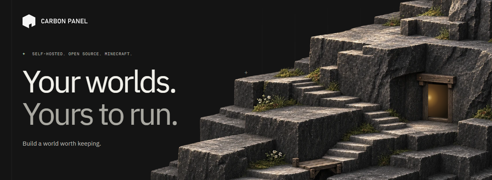
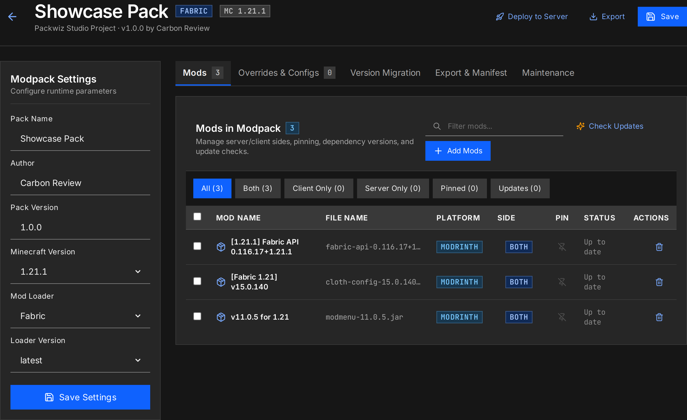
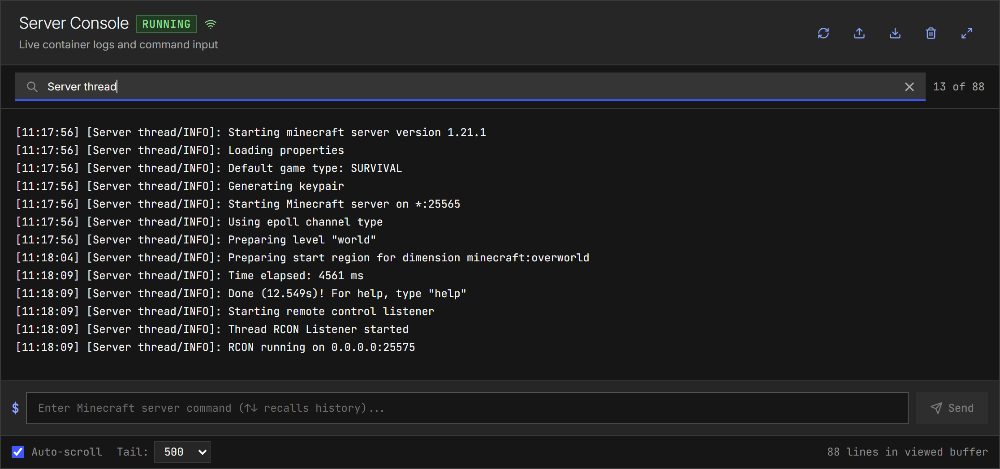
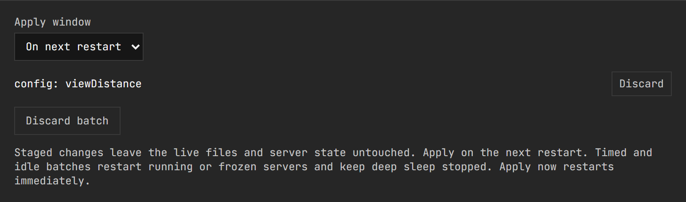
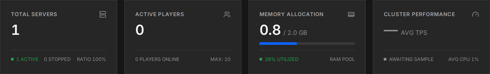
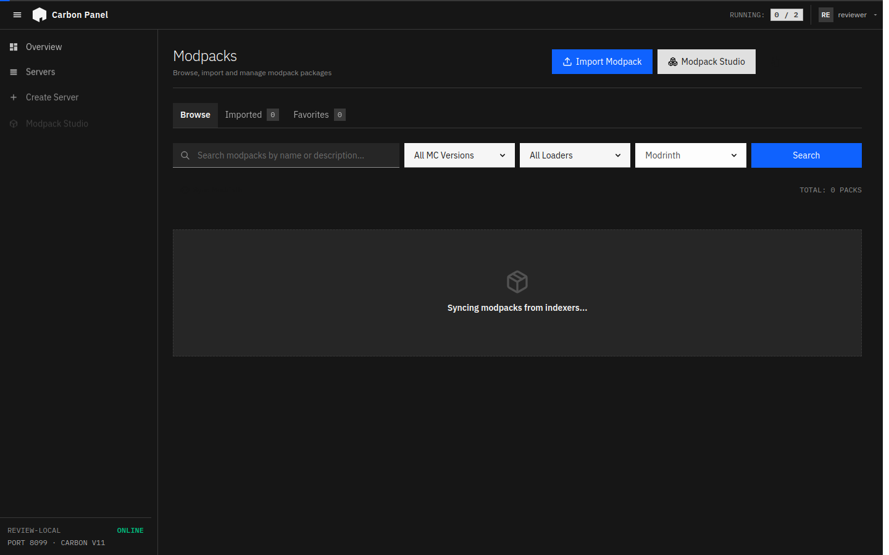

<!--
SPDX-License-Identifier: MIT AND MPL-2.0
This file includes DiscoPanel material under the MIT License,
Copyright (c) 2025 Nicholas W. Heyer. The MIT license text is in LICENSE
and still applies to that inherited material.
Maintainer changes are licensed under the Mozilla Public License, v. 2.0.
If a copy of the MPL was not distributed with this file, You can obtain
one at https://mozilla.org/MPL/2.0/.
-->

<div align="center">
  

  <p><strong>A home for the worlds you make.</strong></p>
  <p>Build your modpacks, look after your servers, and keep every block on your own terms.<br />
  Free, open-source Minecraft server management. Your machines. Your data.</p>

  <p>
    <a href="#quick-start"><strong>Get started ↗</strong></a> &nbsp; · &nbsp;
    <a href="https://carbonpanel.dev/">Explore the website</a> &nbsp; · &nbsp;
    <a href="https://carbonpanel.dev/docs/">Documentation</a> &nbsp; · &nbsp;
    <a href="https://github.com/athNdev/carbonpanel/releases">Releases</a>
  </p>

  <p>
    <a href="https://github.com/athNdev/carbonpanel/actions/workflows/ci.yml"></a>
    <a href="https://github.com/athNdev/carbonpanel/releases"></a>
    <a href="LICENSE.MPL-2.0"></a>
  </p>

</div>

## Modpack Studio. Modpacks, made simple.

Bring your pack together, choose your export format, and get it ready to share
with your players. **Modpack Studio** keeps the workflow in one place.

- **Find your next addition.** Search Modrinth and CurseForge, choose versions,
  and work through dependencies.
- **Shape the pack.** Manage client and server sides, pin versions, and keep
  overrides and configuration alongside your mods.
- **Take it with you.** Export `.mrpack`, CurseForge or packwiz formats, share
  with friends, or deploy to a server.

[](assets/showcase/showcase-studio.png)

[Explore Modpack Studio ↗](https://carbonpanel.dev/docs/guides/modpack-studio/)

## Look after what you build.

Give each server its own Docker container. Keep the console, live logs, files,
backups and settings within reach. Run on a machine at home, a dedicated host,
or compatible remote Docker nodes, all through one panel.

[](assets/showcase/showcase-server-detail.png)

### The next update. When you're ready.

Prepare compatible configuration and content changes in one batch. Review
them together, then choose the next restart, a scheduled time or an idle window.
Staging leaves the live files alone; applying to a running server includes a restart.

[](assets/showcase/showcase-staging.png)

[Read the update guide ↗](https://carbonpanel.dev/docs/guides/staged-updates/)

### Small additions. New adventures.

Browse and install datapacks from the panel, or upload your own ZIP. Manage
the packs in a world's datapacks directory, with pack-format warnings to help
identify compatibility issues.

[Explore datapacks ↗](https://carbonpanel.dev/docs/guides/server-datapacks/)

### Let quiet worlds rest.

Choose how an empty server rests:

| Mode         | What it does                                                              |
| ------------ | ------------------------------------------------------------------------- |
| Native pause | Stops ticking on supported Minecraft versions while retaining memory.     |
| Freeze       | Suspends the process in memory on supported hosts.                        |
| Deep sleep   | Stops the JVM to release its memory; a player connection triggers a wake. |

The panel and proxy continue using their own resources. Cold starts take time,
and a player may need to retry while a server becomes ready. Support and setup
depend on the server version, host and idle-mode configuration.

[How sleep and wake work ↗](https://carbonpanel.dev/docs/guides/sleep-and-wake/)

<details>
<summary><strong>A closer look: dashboard and modpack library</strong></summary>

### Your machines, together



### A home for your packs



</details>

<sub>UI captures come from the current application in an isolated review installation, with seeded review data. [Capture notes and source revision](assets/showcase/README.md).</sub>

### Considered down to the controls.

Quiet surfaces, clear states and a shared set of foundations.
[Explore the Carbon design system ↗](https://carbonpanel.dev/design-system/)

## Features

| Area                   | Included capabilities                                                                                                |
| ---------------------- | -------------------------------------------------------------------------------------------------------------------- |
| Server management      | Vanilla, Paper, Purpur, Fabric, Quilt, Forge, NeoForge, Bedrock and more; per-server containers and resource limits. |
| Player routing         | Hostname-aware proxy routing, Velocity forwarding, PROXY protocol and Bedrock UDP support.                           |
| Modpacks and content   | Create and share modpacks in multiple formats; search for and add datapacks.                                         |
| Updates and scheduling | Staged configuration/content batches, scheduled or idle apply windows, task chains and webhooks.                     |
| Everyday operations    | Live console and RCON, file browsing/editing, archive handling and resumable transfers.                              |
| Backups                | World-aware server backups, retention and S3-compatible offsite storage.                                             |
| Your machines          | Place servers on compatible local or remote Docker nodes and manage them through one panel.                          |
| Access                 | Local accounts, roles and server-scoped permissions, OIDC, API tokens and an audit log.                              |
| Integrations           | Protocol Buffers, Connect RPC/gRPC, an API reference and Prometheus metrics.                                         |

Carbon Panel is under active development. The website documentation displays its
exact application commit, labelled as a development snapshot. Check
[the documentation version](https://carbonpanel.dev/docs/versions/) against
your installation when following a guide.

## Quick start

For the full walkthrough, see
[Docker Compose setup](https://carbonpanel.dev/docs/getting-started/docker-compose/).

Prefer a prebuilt download? [GitHub Releases](https://github.com/athNdev/carbonpanel/releases)
provides versioned archives for Linux, macOS and Windows.
See [release downloads and checksum verification](docs/releases.md).

### 1. Download the repository and build the image

Requires Docker with Linux containers and Docker Compose.

```bash
git clone https://github.com/athNdev/carbonpanel.git
cd carbonpanel
docker build -f docker/Dockerfile.carbon-panel -t carbon-panel:latest .
```

### 2. Choose your persistent storage paths

Review [docker-compose.yml](docker-compose.yml) before starting. Set the host
paths for data and backups to locations you want to keep.

There is no environment variable to keep in sync with those paths: the panel
reads the volume mapping from its own container at startup. If the data
directory is not mounted, is read-only, or the container user cannot write to
it, startup stops with a message naming the directory instead of writing worlds
into a layer that is discarded with the container.

The included Compose file uses host networking. Review the networking notes in
that file if your deployment needs bridge networking instead.

### 3. Start the panel

```bash
docker compose up -d
```

Open <http://localhost:8080> and create the first administrator account.
Create a server, wait for it to become ready, and configure the address players
will use to connect. Keep world data and the panel database when updating or
recreating containers.

## Documentation and help

| You want to...               | Start here                                                                                                       |
| ---------------------------- | ---------------------------------------------------------------------------------------------------------------- |
| Understand the panel         | [Introduction](https://carbonpanel.dev/docs/introduction/)                                                       |
| Install it                   | [Docker Compose](https://carbonpanel.dev/docs/getting-started/docker-compose/)                                   |
| Configure it                 | [Configuration](https://carbonpanel.dev/docs/configuration/) and [config.example.yaml](config.example.yaml)      |
| Back up a server             | [Server backups](https://carbonpanel.dev/docs/guides/backups/)                                                   |
| Configure sign-in            | [OIDC guides](https://carbonpanel.dev/docs/guides/oidc/keycloak/)                                                |
| Use the API                  | [API reference](https://carbonpanel.dev/docs/api/); authenticated requests are required for protected operations |
| Resolve a problem            | [Troubleshooting](https://carbonpanel.dev/docs/troubleshooting/) and [FAQ](https://carbonpanel.dev/docs/faq/)    |
| Check what the docs describe | [Documentation version](https://carbonpanel.dev/docs/versions/)                                                  |

Operator references in this repository include
[server operations](docs/runbook-server-operations.md),
[idle-mode setup](docs/runbook-sleep-baseline.md), and
[panel database recovery](docs/runbook-panel-db-restore.md).

For help or a bug report, include the application commit/version, relevant
configuration and redacted logs in an
[issue](https://github.com/athNdev/carbonpanel/issues). Keep tokens, private
addresses and world data out of public reports.

## Development

The backend is Go; the console is SvelteKit with Bun. See
[the contributing guide](https://carbonpanel.dev/docs/contributing/) for contribution and verification guidance.
Current CI uses Go 1.26 and Bun 1.4.2.

<details>
<summary><strong>Build and run from source</strong></summary>

Build the frontend before compiling a binary that embeds it:

```bash
bash scripts/web-build.sh
go build -o carbon-panel ./cmd/carbon-panel
./carbon-panel
```

For live development:

```bash
bun run dev
# Or use make dev, scripts/dev.ps1, or scripts/dev.sh.
```

The development frontend runs at <http://localhost:5174> and proxies API/RPC
requests to the backend at <http://localhost:8080>.
The default development profile binds to loopback. Use `bun run dev --lan` for
intentional LAN exposure, and Ctrl+C to stop only that session's process trees.
See [development commands](docs/development.md) for tool selection and shutdown.

</details>

## Acknowledgments and credits

Carbon Panel (formerly MineServer) is built upon the open-source foundation of the original
[DiscoPanel](https://github.com/discohaus/discopanel) project created by
[nickheyer](https://github.com/nickheyer).

## License

Carbon Panel's own code is licensed under the **Mozilla Public License 2.0**
([LICENSE.MPL-2.0](LICENSE.MPL-2.0)).

Material inherited from DiscoPanel remains under the **MIT License**
([LICENSE](LICENSE)), Copyright (c) 2025 Nicholas W. Heyer.
[LICENSING.md](LICENSING.md) documents the file-by-file boundary between the two.
