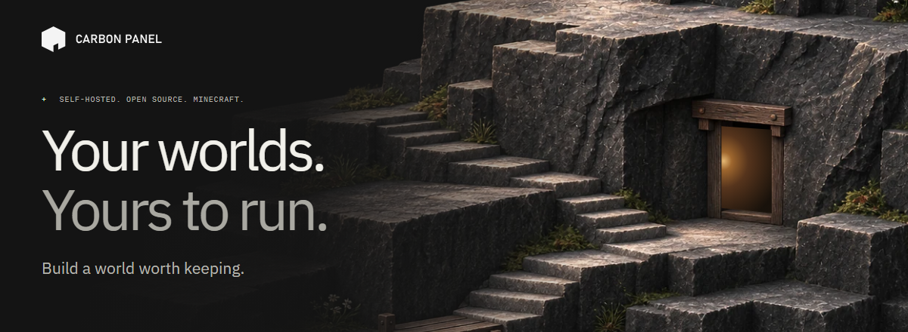
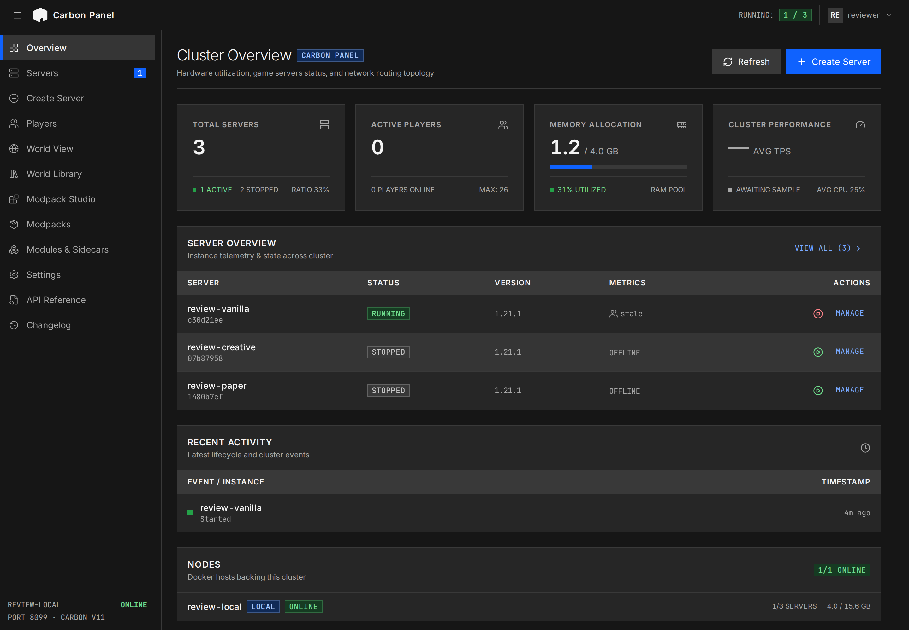
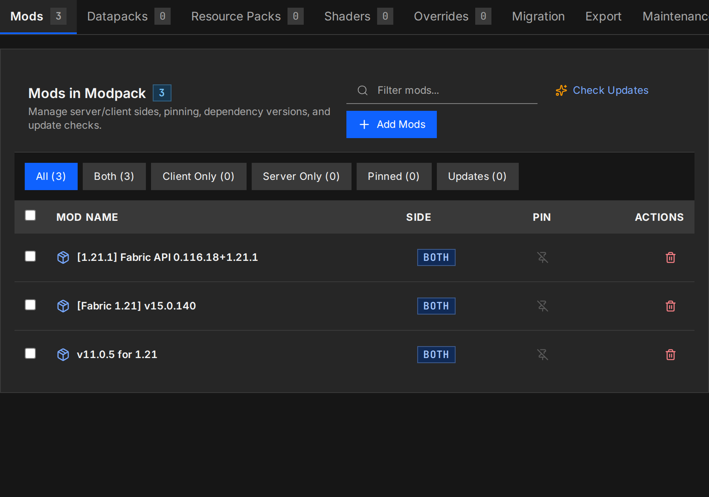
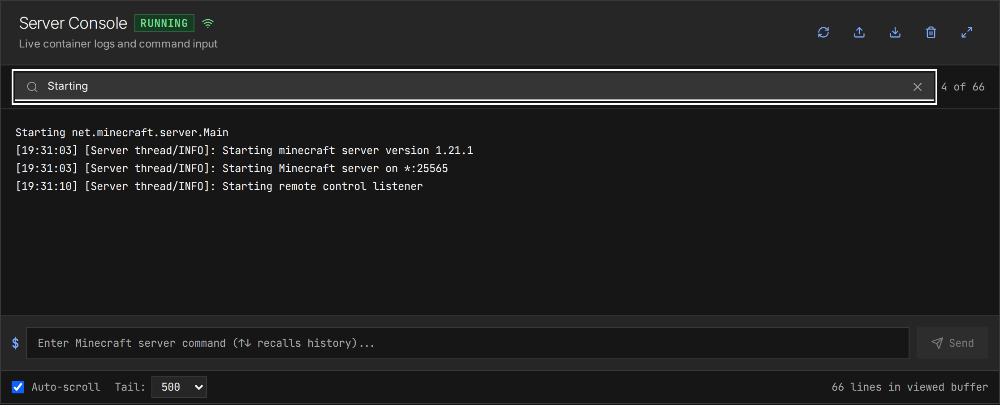
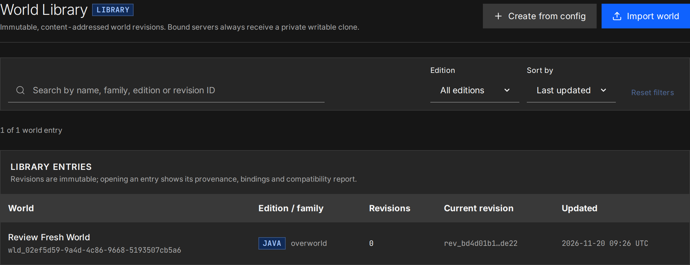
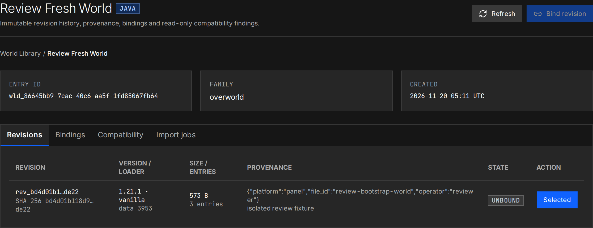
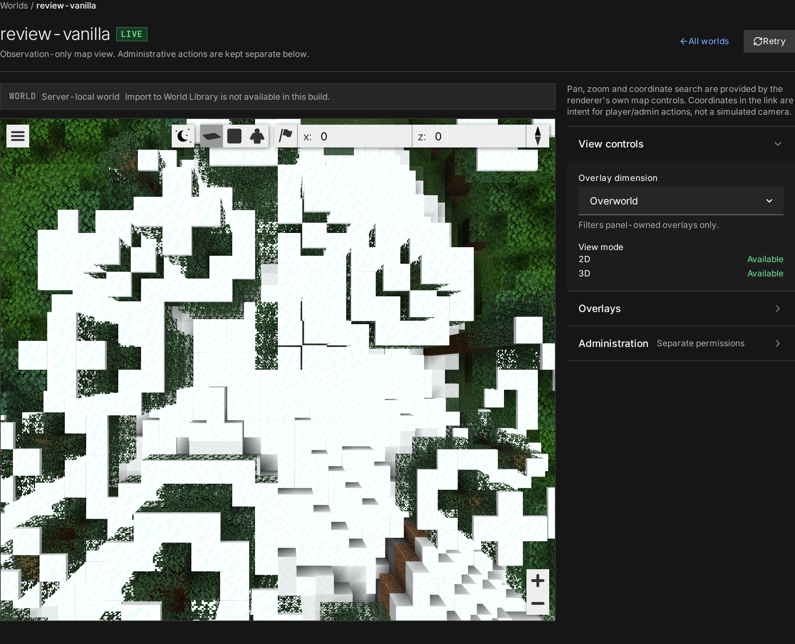
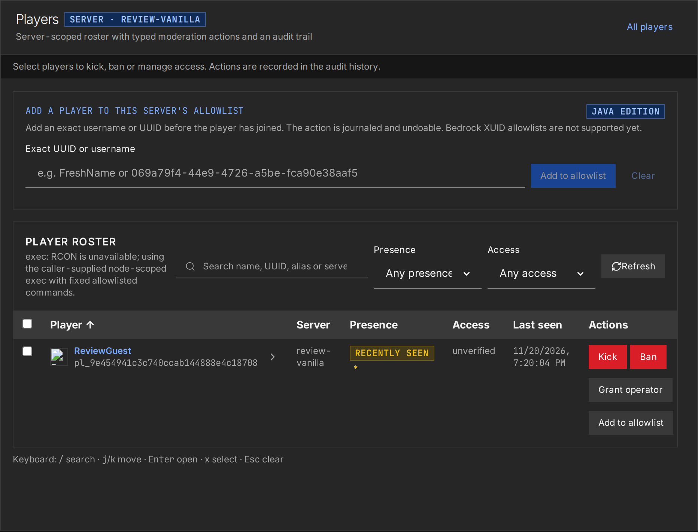
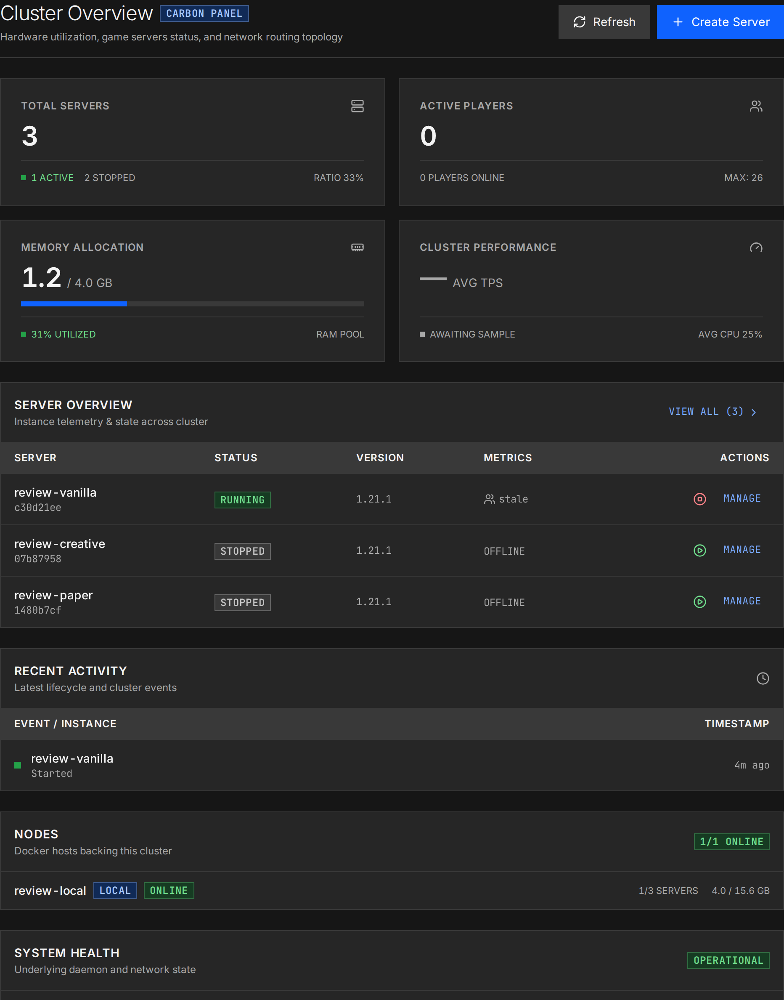
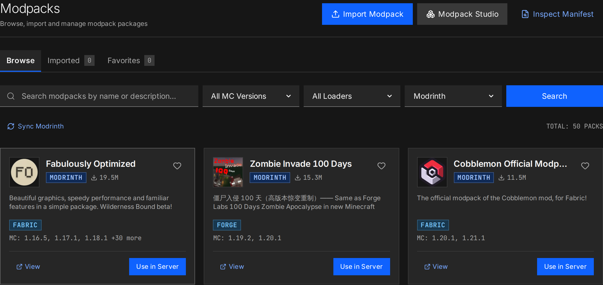

<!--
SPDX-License-Identifier: MIT AND MPL-2.0
This file includes DiscoPanel material under the MIT License,
Copyright (c) 2025 Nicholas W. Heyer. The MIT license text is in LICENSE
and still applies to that inherited material.
Maintainer changes are licensed under the Mozilla Public License, v. 2.0.
If a copy of the MPL was not distributed with this file, You can obtain
one at https://mozilla.org/MPL/2.0/.
-->

<div align="center">
  

  <p><strong>A home for the worlds you make.</strong></p>
  <p>Build your modpacks, look after your servers, and keep every block on your own terms.<br />
  Free, open-source Minecraft server management. Your machines. Your data.</p>

  <p>
    <a href="#quick-start"><strong>Get started ↗</strong></a> &nbsp; · &nbsp;
    <a href="https://carbonpanel.dev/">Explore the website</a> &nbsp; · &nbsp;
    <a href="https://carbonpanel.dev/docs/">Documentation</a> &nbsp; · &nbsp;
    <a href="https://github.com/athNdev/carbonpanel/releases">Releases</a> &nbsp; · &nbsp;
    <a href="https://hub.docker.com/r/atharvnaphade/carbonpanel">Docker image</a>
  </p>

  <p>
    <a href="https://github.com/athNdev/carbonpanel/actions/workflows/ci.yml"></a>
    <a href="https://github.com/athNdev/carbonpanel/releases"></a>
    <a href="LICENSE.MPL-2.0"></a>
  </p>

</div>

[](https://github.com/athNdev/carbonpanel/blob/showcase-assets/assets/showcase/showcase-dashboard-full.png)

[View the full-resolution dashboard capture ↗](https://github.com/athNdev/carbonpanel/blob/showcase-assets/assets/showcase/showcase-dashboard-full.png)

## Modpack Studio. Modpacks, made simple.

Bring your pack together, choose your export format, and get it ready to share
with your players. **Modpack Studio** keeps the workflow in one place.

- **Find your next addition.** Search Modrinth and CurseForge, choose versions,
  and work through dependencies.
- **Shape the pack.** Manage client and server sides, pin versions, and keep
  overrides and configuration alongside your mods.
- **Take it with you.** Export `.mrpack`, CurseForge or packwiz formats, share
  with friends, or deploy to a server.

[](https://github.com/athNdev/carbonpanel/blob/showcase-assets/assets/showcase/showcase-studio.png)

[Explore Modpack Studio ↗](https://carbonpanel.dev/docs/guides/modpack-studio/)

## Look after what you build.

Give each server its own Docker container. Keep the console, live logs, files,
backups and settings within reach. Run on a machine at home, a dedicated host,
or compatible remote Docker nodes, all through one panel.

[](https://github.com/athNdev/carbonpanel/blob/showcase-assets/assets/showcase/showcase-server-detail.png)

### Worlds, kept as revisions.

Keep a world snapshot as an immutable library revision, then review its
provenance before binding it to a server.

[](https://github.com/athNdev/carbonpanel/blob/showcase-assets/assets/showcase/showcase-library.png)

[](https://github.com/athNdev/carbonpanel/blob/showcase-assets/assets/showcase/showcase-library-revisions.png)

### Look inside a world.

Open a rendered map of a world in the panel, with real terrain tiles and the renderer's own pan and zoom controls.

[](https://github.com/athNdev/carbonpanel/blob/showcase-assets/assets/showcase/showcase-world-view.png)

[View the full-resolution World View capture ↗](https://github.com/athNdev/carbonpanel/blob/showcase-assets/assets/showcase/showcase-world-view.png)

### Decide who connects.

Add a player to a server's allowlist before they have joined, with a typed,
auditable action.

[](https://github.com/athNdev/carbonpanel/blob/showcase-assets/assets/showcase/showcase-player-allowlist.png)

### The next update. When you're ready.

Prepare compatible configuration and content changes in one batch. Review
them together, then choose the next restart, a scheduled time or an idle window.
Staging leaves the live files alone; applying to a running server includes a restart.

[Read the update guide ↗](https://carbonpanel.dev/docs/guides/staged-updates/)

### Small additions. New adventures.

Browse and install datapacks from the panel, or upload your own ZIP. Manage
the packs in a world's datapacks directory, with pack-format warnings to help
identify compatibility issues.

[Explore datapacks ↗](https://carbonpanel.dev/docs/guides/server-datapacks/)

### Let quiet worlds rest.

Choose how an empty server rests:

| Mode         | What it does                                                              |
| ------------ | ------------------------------------------------------------------------- |
| Native pause | Stops ticking on supported Minecraft versions while retaining memory.     |
| Freeze       | Suspends the process in memory on supported hosts.                        |
| Deep sleep   | Stops the JVM to release its memory; a player connection triggers a wake. |

The panel and proxy continue using their own resources. Cold starts take time,
and a player may need to retry while a server becomes ready. Support and setup
depend on the server version, host and idle-mode configuration.

[How sleep and wake work ↗](https://carbonpanel.dev/docs/guides/sleep-and-wake/)

<details>
<summary><strong>A closer look: dashboard and modpack library</strong></summary>

### Your machines, together



### A home for your packs



</details>

<sub>UI captures come from the current application in an isolated review installation, with seeded review data. Images are published to a dedicated `showcase-assets` branch so these URLs stay stable; [capture notes, manifest and source revision](assets/showcase/README.md).</sub>

### Considered down to the controls.

Quiet surfaces, clear states and a shared set of foundations.
[Explore the Carbon design system ↗](https://carbonpanel.dev/design-system/)

## Features

| Area                   | Included capabilities                                                                                                |
| ---------------------- | -------------------------------------------------------------------------------------------------------------------- |
| Server management      | Vanilla, Paper, Purpur, Fabric, Quilt, Forge, NeoForge, Bedrock and more; per-server containers and resource limits. |
| Player routing         | Hostname-aware proxy routing, Velocity forwarding, PROXY protocol and Bedrock UDP support.                           |
| Modpacks and content   | Create and share modpacks in multiple formats; search for and add datapacks.                                         |
| Updates and scheduling | Staged configuration/content batches, scheduled or idle apply windows, task chains and webhooks.                     |
| Everyday operations    | Live console and RCON, file browsing/editing, archive handling and resumable transfers.                              |
| Backups                | World-aware server backups, retention and S3-compatible offsite storage.                                             |
| Your machines          | Place servers on compatible local or remote Docker nodes and manage them through one panel.                          |
| Access                 | Local accounts, roles and server-scoped permissions, OIDC, API tokens and an audit log.                              |
| Integrations           | Protocol Buffers, Connect RPC/gRPC, an API reference and Prometheus metrics.                                         |

Carbon Panel is under active development. The website documentation displays its
exact application commit, labelled as a development snapshot. Check
[the documentation version](https://carbonpanel.dev/docs/versions/) against
your installation when following a guide.

## Quick start

For the full walkthrough, see
[Docker Compose setup](https://carbonpanel.dev/docs/getting-started/docker-compose/).

Prefer a prebuilt download? [GitHub Releases](https://github.com/athNdev/carbonpanel/releases)
provides versioned archives for Linux, macOS and Windows.
See [release downloads and checksum verification](docs/releases.md) and the
[release history and tag migration](docs/release-history.md): product releases
use `carbonpanel-vMAJOR.MINOR.PATCH` tags, while plain `v*` tags remain the
separate Go/module domain. The verified stable is `1.0.40` (`v1.0.40`), the
current 1.0 rollback line; see the upgrade notes before moving to the next
MAJOR release. Prereleases never move `latest` or a minor alias.

### 1. Download the repository and build or pull the image

Requires Docker with Linux containers and Docker Compose.

```bash
git clone https://github.com/athNdev/carbonpanel.git
cd carbonpanel
docker build -f docker/Dockerfile.carbon-panel -t carbon-panel:latest .
```

Or pull the published multi-architecture image from
[Docker Hub](https://hub.docker.com/r/atharvnaphade/carbonpanel):

```bash
docker pull atharvnaphade/carbonpanel:latest
```

### 2. Choose your persistent storage paths

Review [docker-compose.yml](docker-compose.yml) before starting. Set the host
paths for data and backups to locations you want to keep.

There is no environment variable to keep in sync with those paths: the panel
reads the volume mapping from its own container at startup. If the data
directory is not mounted, is read-only, or the container user cannot write to
it, startup stops with a message naming the directory instead of writing worlds
into a layer that is discarded with the container.

The included Compose file uses host networking. Review the networking notes in
that file if your deployment needs bridge networking instead.

### 3. Start the panel

```bash
docker compose up -d
```

Open <http://localhost:8080> and create the first administrator account.
Create a server, wait for it to become ready, and configure the address players
will use to connect. Keep world data and the panel database when updating or
recreating containers.

## AI assistant integration (MCP)

Carbon Panel can expose a read-first MCP stdio server to an AI assistant. The
MCP artifact is **separately versioned and separately owned** from Carbon Panel
releases: its version does not move the panel's `latest` tag, its minor tags or
any Docker Hub panel image, and it is not a GitHub Release. The user guide is
[MCP server](docs/carbon-panel/src/content/docs/guides/mcp-server.mdx); the
smoke and evidence procedure is [MCP distribution smoke](docs/runbook-mcp-smoke.md).

**Publication status:** the artifacts, manifest, workflow and procedure are
prepared here. At the time of this change no image has been pushed to GHCR and
no MCP Registry entry has been submitted. Do not substitute a locally built or
preview artifact for the official stable one when it is published.

The implemented catalogue mounts the generated **211-tool combined catalogue**.
It is derived from 251 declared RPCs across 26 proto services, of which 241 are
mounted/reachable across 27 mounted services. Tool coverage is not the same as
RPC coverage; the audit matrix records 201 supported operations (all listed,
reachable and verified) and 78 excluded operations with exact reasons and
equivalent flows. Do not infer that every panel RPC has a tool.

A successful client install proves only that the **package is available**. It
does **not** prove that a tool works against your panel: **server capabilities**
come from the panel build behind `CARBONPANEL_URL`. The latest stable panel,
`v1.0.40` (`f88748be6a216b187e675bbb1f110df07e544148`), predates the player,
world and world-view RPCs. The pinned post-stable build
(`fa23a8d73c181f9907633024d9023aead928324e`) contains them but is not the
stable install path. See the matrix below. The server requires an
**authentication-enabled** panel: it refuses legacy no-auth installations and
uses a real `dp_` API token, never anonymous access.

Copy/paste this into your agent when the official artifact is available:

```text
Connect me to my self-hosted Carbon Panel — an EXISTING install or a NEW one —
using the OFFICIAL, STABLE, PINNED MCP artifact. Do not build or substitute a
local/preview image.

0. Decide the panel build first. The default is STABLE (v1.0.40 or later), and
   the panel MUST be authentication-enabled: a legacy no-auth installation is
   refused. You MAY start a NEW self-hosted install: follow the normal
   install docs, create the first admin account, then a dedicated API token.
   A new install must NOT replace, reconfigure, migrate or delete an existing
   panel, world or database; if one exists, use it instead. For an EXISTING
   install, do NOT re-run an installer, recreate containers or change its
   channel. Do NOT switch any install to nightly automatically: only I, the
   operator, choose a qualified nightly build as a separate, backed-up change.
1. Use the exact official stable MCP artifact version and its immutable
   ghcr.io sha256 digest. Never use :latest, @main, a branch tag or a moving
   minor tag. Pin the version and digest in the client config.
2. Create a dedicated, expiring, least-privilege Carbon Panel API token — a real
   `dp_` token, not a session token or an anonymous/no-auth bypass — and pass it
   only through the client env CARBONPANEL_TOKEN. Never commit a token or put
   one in arguments, stdout or logs. Missing or invalid credentials are errors,
   never an anonymous fallback.
3. Use a panel URL REACHABLE FROM THE MCP PROCESS. A host-installed MCP binary
   may use http://127.0.0.1:8080. A containerized MCP client on the panel's
   Docker network must use the panel's COMPOSE SERVICE NAME and port (for the
   shipped Compose file, http://carbon-panel:8080) — `localhost` inside the
   MCP container is the MCP container itself and must never be used as a
   fallback. No host-network assumption or published-port guess is allowed.
4. Preserve my data. Do not run docker compose down -v, docker system prune,
   rm -rf on data paths, or any delete/stop/start/recreate command. The MCP
   connection mounts no world, database or backup directory and no Docker
   socket. Confirm worlds and the panel database are intact before and after.
5. Use the read-only tool set qualified for my panel build. On stable, the
   verified minimal set is list_servers, get_server, list_files, get_file and
   list_backups. The combined catalogue mounts 211 tools (251 declared / 241
   mounted RPCs). The PlayerService,
   WorldService and WorldViewService tools are mounted, but their backing RPCs
   are absent from stable v1.0.40: on that build return the structured
   CAPABILITY_UNAVAILABLE error with the required qualified build; do not report
   success, guess from your client version, or silently skip the call.
6. Check health first: GET /healthz, /readyz and /health/detail on the panel
   from where the MCP process runs. Report healthy, degraded/unavailable and
   unknown separately. A stored Running status alone is not playable evidence.
7. Demonstrate read-only behaviour: call tools/list, then list_servers, and
   show the result. Stop and report if any tool asks for a write. Verify logs
   go to stderr and stdout contains only JSON-RPC.
```

Two distinct connection cases — pick the one that matches where the MCP
process runs. `<...>` placeholders must be replaced with the published stable
version and real digest.

**(a) Host-installed MCP binary** (the binary runs on the Docker host, so
loopback reaches a panel published on that host):

```json
{
  "mcpServers": {
    "carbon-panel": {
      "command": "<PATH_TO_MCP_BINARY>",
      "args": ["stdio"],
      "env": {
        "CARBONPANEL_URL": "http://127.0.0.1:8080",
        "CARBONPANEL_TOKEN": "dp_<DEDICATED_EXPIRING_API_TOKEN>"
      }
    }
  }
}
```

**(b) Compose-deployed MCP container** (the MCP process is in a separate
container attached to the panel's Compose network, so it must use the panel's
service DNS name and port):

```json
{
  "mcpServers": {
    "carbon-panel": {
      "command": "docker",
      "args": [
        "run", "-i", "--rm",
        "--network", "<COMPOSE_NETWORK>",
        "-e", "CARBONPANEL_URL",
        "-e", "CARBONPANEL_TOKEN",
        "ghcr.io/athndev/carbonpanel-mcp:<STABLE_VERSION>@sha256:<64_HEX_DIGEST>"
      ],
      "env": {
        "CARBONPANEL_URL": "http://carbon-panel:8080",
        "CARBONPANEL_TOKEN": "dp_<DEDICATED_EXPIRING_API_TOKEN>"
      }
    }
  }
}
```

For case (a), use the official stable binary release and verify its published
checksum; do not use a locally built, preview or `latest` binary. For case (b),
get `<COMPOSE_NETWORK>` from `docker compose config`; the service name is
`carbon-panel` in the shipped [docker-compose.yml](docker-compose.yml). Never
use `localhost` or `127.0.0.1` as a fallback inside the MCP container: that
address is the MCP container itself, not the panel. The shipped Compose file
uses host networking by default, so a host-installed binary can use case (a);
a separate container still needs an explicitly shared network and DNS. No
Docker socket is mounted in either case.

OS notes: on **Windows** use Docker Desktop with WSL2 and
`%APPDATA%\Claude\claude_desktop_config.json` (double backslashes in any host
path); on **macOS** use `~/Library/Application Support/Claude/claude_desktop_config.json`
and the `arm64` or `amd64` image matching your Mac; on **Linux** use
`~/.config/Claude/claude_desktop_config.json` and keep it `chmod 600`. Only
Linux is fully supported and tested — Windows installations may have issues.

### Compatibility: package availability is not server capability

The gateway mounts the generated **211-tool combined catalogue** (251 declared
RPCs, 241 mounted/reachable). All ten tools below are mounted; the columns
report whether the panel build behind `CARBONPANEL_URL` implements the RPC that
backs each tool. Exclusions and policy boundaries are recorded in the OSS-375
audit matrix. Tool names below match the implemented catalogue exactly.

| Tool (read-only) | Backing RPC | Stable `v1.0.40` | Pinned post-stable build |
| --- | --- | --- | --- |
| `list_servers` | `ServerService/ListServers` | available | available |
| `get_server` | `ServerService/GetServer` | available | available |
| `list_files` | `FileService/ListFiles` | available | available |
| `get_file` | `FileService/GetFile` | available | available |
| `list_backups` | `BackupService/ListBackups` | available | available |
| `list_players` | `PlayerService/ListPlayers` | RPC absent (tool mounted) | mounted; pinned, qualification pending |
| `get_player` | `PlayerService/GetPlayer` | RPC absent (tool mounted) | mounted; pinned, qualification pending |
| `list_world_entries` | `WorldService/ListWorldEntries` | RPC absent (tool mounted) | mounted; pinned, qualification pending |
| `list_world_view_targets` | `WorldViewService/ListWorldViewTargets` | RPC absent (tool mounted) | mounted; pinned, qualification pending |
| `get_world_view_status` | `WorldViewService/GetWorldViewStatus` | RPC absent (tool mounted) | mounted; pinned, qualification pending |

The pinned post-stable candidate is
`fa23a8d73c181f9907633024d9023aead928324e`; "qualification pending" means the
build contains the RPC but no smoke evidence has been recorded yet.
`PlayerService`, `WorldService` and `WorldViewService` are absent from
`v1.0.40`. Never infer capability from the MCP client version or from a
successful install.

When an RPC is missing or returns `Unimplemented`, the tool result is an
honest structured error, not a success or a silent omission:

```json
{"error":{"code":"CAPABILITY_UNAVAILABLE","tool":"list_players",
 "rpc":"carbonpanel.v1.PlayerService/ListPlayers",
 "required_panel_build":"post-v1.0.40+fa23a8d73c181f9907633024d9023aead928324e","observed_panel_build":"v1.0.40 (f88748be)",
 "retryable":false,"guidance":"Upgrade the panel in a separate operator-initiated change."}}
```

The final error field names are owned by the core implementation lane; the
`CAPABILITY_UNAVAILABLE` semantic and `isError: true` behaviour are required.
Verification to date is fixture/proto based: no image has been pushed, no
registry entry exists, and no live fresh-install smoke has been run.

## Documentation and help

| You want to...               | Start here                                                                                                       |
| ---------------------------- | ---------------------------------------------------------------------------------------------------------------- |
| Understand the panel         | [Introduction](https://carbonpanel.dev/docs/introduction/)                                                       |
| Install it                   | [Docker Compose](https://carbonpanel.dev/docs/getting-started/docker-compose/)                                   |
| Install on Proxmox           | [Proxmox guide (prepared CT preview / existing guest)](docs/carbon-panel/src/content/docs/getting-started/proxmox.mdx) and [CT archive preview](https://github.com/athNdev/carbonpanel/releases/download/controller-ct-v0.1.0/carbonpanel-controller-ct.tar.zst) |
| Connect an AI assistant      | [MCP server guide](docs/carbon-panel/src/content/docs/guides/mcp-server.mdx) (build-bound tool compatibility)     |
| Configure it                 | [Configuration](https://carbonpanel.dev/docs/configuration/) and [config.example.yaml](config.example.yaml)      |
| Back up a server             | [Server backups](https://carbonpanel.dev/docs/guides/backups/)                                                   |
| Configure sign-in            | [OIDC guides](https://carbonpanel.dev/docs/guides/oidc/keycloak/)                                                |
| Use the API                  | [API reference](https://carbonpanel.dev/docs/api/); authenticated requests are required for protected operations |
| Resolve a problem            | [Troubleshooting](https://carbonpanel.dev/docs/troubleshooting/) and [FAQ](https://carbonpanel.dev/docs/faq/)    |
| Check what the docs describe | [Documentation version](https://carbonpanel.dev/docs/versions/)                                                  |

Operator references in this repository include
[server operations](docs/runbook-server-operations.md),
[idle-mode setup](docs/runbook-sleep-baseline.md), and
[panel database recovery](docs/runbook-panel-db-restore.md).

For help or a bug report, include the application commit/version, relevant
configuration and redacted logs in an
[issue](https://github.com/athNdev/carbonpanel/issues). Keep tokens, private
addresses and world data out of public reports.

## Development

The backend is Go; the console is SvelteKit with Bun. See
[the contributing guide](https://carbonpanel.dev/docs/contributing/) for contribution and verification guidance.
Current CI uses Go 1.26 and Bun 1.4.2.

<details>
<summary><strong>Build and run from source</strong></summary>

Build the frontend before compiling a binary that embeds it:

```bash
bash scripts/web-build.sh
go build -o carbon-panel ./cmd/carbon-panel
./carbon-panel
```

For live development:

```bash
bun run dev
# Or use make dev, scripts/dev.ps1, or scripts/dev.sh.
```

The development frontend runs at <http://localhost:5174> and proxies API/RPC
requests to the backend at <http://localhost:8080>.
The default development profile binds to loopback. Use `bun run dev --lan` for
intentional LAN exposure, and Ctrl+C to stop only that session's process trees.
See [development commands](docs/development.md) for tool selection and shutdown.

</details>

## Acknowledgments and credits

Carbon Panel (formerly MineServer) is built upon the open-source foundation of the original
[DiscoPanel](https://github.com/discohaus/discopanel) project created by
[nickheyer](https://github.com/nickheyer).

## License

Carbon Panel's own code is licensed under the **Mozilla Public License 2.0**
([LICENSE.MPL-2.0](LICENSE.MPL-2.0)).

Material inherited from DiscoPanel remains under the **MIT License**
([LICENSE](LICENSE)), Copyright (c) 2025 Nicholas W. Heyer.
[LICENSING.md](LICENSING.md) documents the file-by-file boundary between the two.
